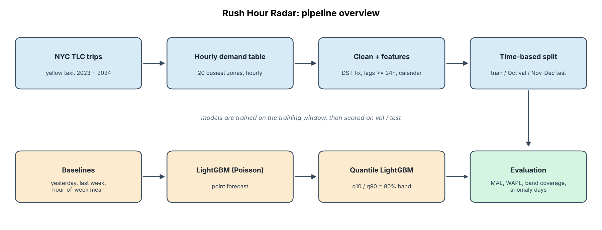
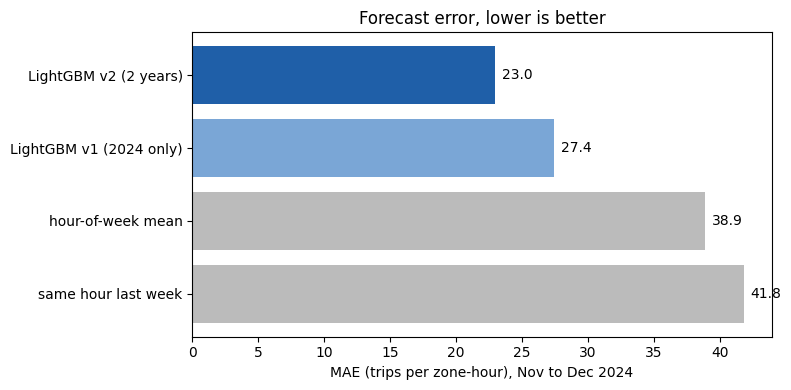
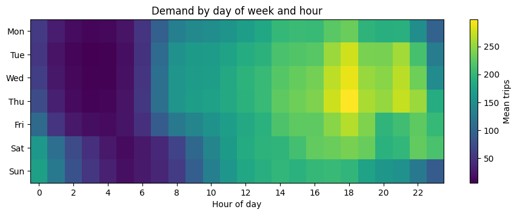
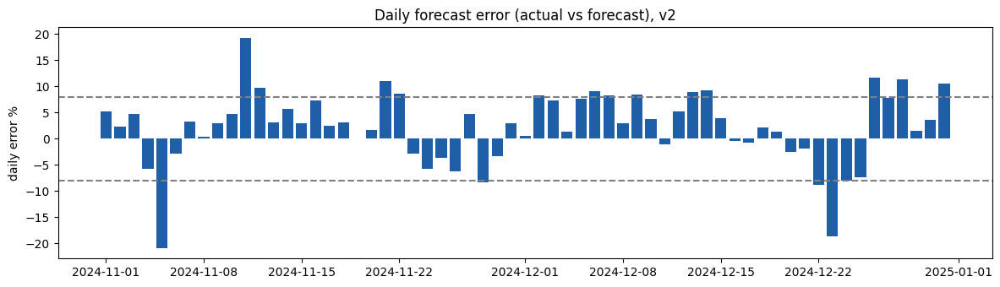

# 🚕 Rush Hour Radar: NYC taxi demand forecasting

Forecasts **hourly yellow-taxi pickups for the 20 busiest NYC zones, a day ahead**, with **80% prediction intervals**,
and an interactive **Streamlit dashboard** to explore the forecasts.
Built on NYC TLC trip data (2023 and 2024, about 350,000 zone-hours) with LightGBM.


   **Live demo:** https://rush-hour-radar-gs.streamlit.app/




## Results

### Held-out test: Nov to Dec 2024

| Model | MAE | RMSE | WAPE |
|---|---|---|---|
| Same hour yesterday | 40.1 | 65.1 | 0.257 |
| Same hour last week | 41.8 | 69.9 | 0.268 |
| Hour-of-week mean (best baseline) | 38.9 | 60.2 | 0.249 |
| LightGBM v1 (2024 data only) | 27.4 | 43.1 | 0.176 |
| **LightGBM v2 (2023 + 2024 data)** | **23.0** | **36.6** | **0.147** |



- v2 has about **41% lower MAE** than the best baseline and about 16% lower than v1.
- **80% prediction band:** 77.3% empirical coverage on the test months (v1: 71.1%). On the October validation month, coverage was 81.3%.
- MAE and RMSE are in trips per zone-hour. WAPE = total absolute error / total actual trips (used instead of MAPE because some hours have zero trips).

Full numbers, including validation, are in [`results/metrics.csv`](results/metrics.csv).

### Rolling backtest (April to December 2024): v2 vs v3 (+ weather)

Each month is predicted by a model trained only on earlier data (expanding window, fixed settings, no early stopping).
v3 adds observed hourly temperature and precipitation (Open-Meteo) to v2. Month-by-month MAE and 80% band coverage are in
the dashboard's **Backtest results** tab and in `data/backtest_metrics.csv` and `data/backtest_coverage.csv`.

| Model | Mean monthly MAE | Mean monthly WAPE |
|---|---|---|
| Same hour last week | 31.6 | 0.213 |
| Hour-of-week mean | 29.4 | 0.198 |
| LightGBM v2 | **21.6** | **0.145** |
| LightGBM v3 (+ weather) | 22.1 | 0.148 |

- Both LightGBM models beat the best baseline in every month, with about 26% lower MAE than the hour-of-week mean.
- **Weather did not help.** v3 beat v2 in only 4 of 9 months and is slightly worse on average. Observed weather is also an upper bound for what a real weather forecast would give, so this is a negative result worth reporting.
- The 80% band covers **76.9%** of hours over the backtest (monthly range 74.5% to 79.6%), slightly narrower than the 80% target.
- The dashboard shows the v3 forecasts. v2 and v3 are shown side by side in the Backtest results tab.

## Dashboard

`app.py` is a Streamlit app that replays the stored backtest forecasts (not a live forecast):

- **Day view:** actual vs forecast by hour for any of the 20 zones, with the 80% band and daily summary metrics
- **Calendar view:** daily forecast error for one zone or all zones, plus the ten worst days
- **Backtest results:** error by month for each model and band coverage
- **About:** method and limitations

## What the data shows



- Weekdays have a sharp morning commute ramp and an evening peak around 5 to 6 pm. Weekends start later, peak lower, and run busier after midnight.
- Zones differ in daily shape, not only in level, so zone is a model feature.
- The two daylight-saving hours of each year are artifacts: the spring-forward hour has no trips and the fall-back hour has two hours merged into one. They are removed before modeling.

More plots in [`figures/`](figures/).

## Approach

1. **Data:** download monthly TLC parquet files, count pickups per hour for the 20 busiest pickup zones, fill missing hours with zeros.
2. **Cleaning:** remove the 2 daylight-saving hours per year.
3. **Validation:** chronological split only (no random split). v1: train Jan to Sep 2024, validate Oct, test Nov to Dec. v2 adds 2023 to the training window.
4. **Baselines:** same hour yesterday, same hour last week, hour-of-week average per zone.
5. **Model:** LightGBM with Poisson loss. Features: zone, hour, day of week, holiday flags, and lagged demand (24h, 1 week, 2 weeks, mean of the last 4 weeks). All lags are at least 24 hours old, so the forecast is valid a day ahead.
6. **Uncertainty:** two quantile LightGBM models (10th and 90th percentile) form an 80% interval.
7. **Error analysis:** hours far outside the band and days where the daily total is far off the forecast.
8. **v2:** after v1 failed on Christmas week (it had never seen a December), 2023 data and calendar flags (holiday eve and after, Christmas period, month) were added.
9. **v3 and rolling backtest:** hourly weather added; each month from April to December 2024 predicted by a model trained only on earlier data.

## Findings from the error analysis

- Unusual days are mostly calendar effects the model has no flag for, plus a few unexplained citywide dips and spikes.
- On the October validation month, Columbus Day (Oct 14) demand was about 16% above forecast.
- On the test set, v1 under-forecast Christmas Eve by about 38%. v2 brought that to about 8%.

| Day | v1 error | v2 error |
|---|---|---|
| Dec 24 | -37.7% | -8.0% |
| Dec 25 | -35.7% | -7.3% |
| Dec 31 | -26.0% | +10.6% |
| Nov 5 (Election Day) | -21.0% | -20.9% |
| Dec 6 | +16.9% | +9.1% |



## Limitations (please read)

- **v2 is not a clean holdout.** The v2 calendar features and the decision to add 2023 data were made after looking at v1's test errors. The v1 numbers are the clean test result; v2 is the "improved after diagnosing failures" result.
- **Zone selection leak (small):** the 20 zones were picked using trip counts from all of 2024, including Nov and Dec.
- **Weather is observed, not forecast.** In real use a day-ahead model would receive a weather forecast, so the gain from v3 is an upper bound. One weather point is used for the whole city.
- **Only two years of data, one city.** Holiday effects are learned from one example per holiday, which is why Dec 31 overshot.
- **Feature and setting choices were made while looking at 2024 results**, so no backtest month is a perfectly clean test.
- **No event data.** Election Day and other local events are still badly missed.
- **Bands are slightly too narrow** in the holiday season (77% coverage against an 80% target).
- The v2 point model reached its 3,000-round cap and could train longer; it was left unchanged to keep reported numbers reproducible.
- Validation (October) was also used for early stopping, so validation scores are slightly optimistic. The test set was scored once per version.
- The dashboard replays stored backtest predictions. It is not a live forecasting service.

## Repository contents

```
rush-hour-radar/
  app.py                    # Streamlit dashboard
  rush_hour_radar.ipynb     # full pipeline, run top to bottom (Google Colab)
  requirements.txt          # dashboard dependencies
  requirements-notebook.txt # notebook dependencies (adds LightGBM etc.)
  data/                     # dashboard data exported by the notebook
  results/metrics.csv       # validation and test metrics (v1, v2, baselines)
  figures/                  # pipeline diagram and result plots
  .streamlit/config.toml
  LICENSE
  README.md
```

## How to run

### Dashboard (local)

```bash
git clone https://github.com/<your-username>/rush-hour-radar.git
cd rush-hour-radar
python -m venv .venv && source .venv/bin/activate   # Windows: .venv\Scripts\activate
pip install -r requirements.txt
streamlit run app.py
```

The data files in `data/` are included, so it runs without retraining.

### Retrain from scratch (Colab)

The notebook stores intermediate files in Google Drive.

1. Open `rush_hour_radar.ipynb` in Colab.
2. Run all cells in order (about 1 hour in total, mostly model training). Allow Drive access when asked.
3. Section 13 writes the dashboard files to `rush-hour-radar/dashboard_data/` on Drive. Copy them into `data/`.

To run the notebook locally, `pip install -r requirements-notebook.txt`, remove the Drive-mount cells, and replace the `/content/drive/MyDrive/rush-hour-radar` paths with a local folder.

### Deploy on Streamlit Community Cloud

1. Push this repo to GitHub (public, or private with access granted).
2. At [share.streamlit.io](https://share.streamlit.io), choose **Create app**, select the repo, branch `main`, main file `app.py`.
3. Deploy. It installs `requirements.txt` automatically.

## Data

[NYC TLC Trip Record Data](https://www.nyc.gov/site/tlc/about/tlc-trip-record-data.page), yellow taxi trips, 2023 and 2024. Raw files are downloaded by the notebook and are not stored in this repository.
Weather: [Open-Meteo historical archive](https://open-meteo.com/) (hourly temperature and precipitation, Central Park area).

## Tech

Python, pandas, NumPy, LightGBM, Altair, Streamlit, Matplotlib, Google Colab.

## License

MIT. See [LICENSE](LICENSE).
